<div align="center">

# AxeMobile

Keep an eye on your Bitaxe, NerdAxe and NerdQaxe miners from your PC, your Mac or your Umbrel.

[](https://github.com/IsSasoriDev/AxeMobile/stargazers)
[](https://github.com/IsSasoriDev/AxeMobile/releases)
[](https://github.com/IsSasoriDev/AxeMobile/issues)

**[Download](https://github.com/IsSasoriDev/AxeMobile/releases)** · **[Umbrel](#umbrel)** · **[Build it yourself](#building)** · **[AxeForge firmware](https://github.com/IsSasoriDev/AxeForge)**

</div>

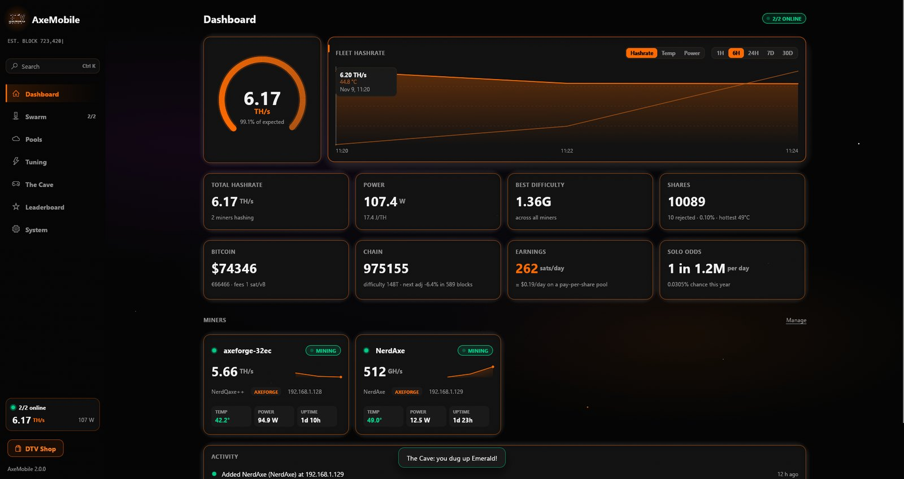

Five little miners shouldn't mean five browser tabs. AxeMobile puts them all in one window, keeps
their history, and lets you change pools or clocks without opening each miner's own page.

Version 2 is a full rewrite. It works with miners running my [AxeForge](https://github.com/IsSasoriDev/AxeForge)
firmware and with the stock AxeOS firmware, and it reads and writes both.

## What you get

**The dashboard.** Total hashrate on a gauge, a chart of hashrate, temperature or power from one hour
to thirty days, power and J/TH, best share, shares and rejects. There's also the Bitcoin price, fees, the
chain height, what your fleet would earn on a pay-per-share pool, and how likely it is to hit a block
solo. Every miner tile has a little six-hour trend line.

**A page for every miner.** The same layout as the AxeForge web page: chip and VR temps, power, fans,
the pool it's on, best shares, firmware, uptime, Wi-Fi, and its own history. A row underneath shows
the last 24 hours: average and peak hashrate, average temperature, and how often it answered.

**Ctrl+K.** Opens a search box: type a few letters to jump to any page or miner, restart a miner,
open its web page, scan the network or switch theme.

**Swarm.** Add a miner by IP, scan your network for them, or pull in every miner an AxeForge unit
already knows about.

**Pools and tuning.** Edit every pool slot, switch AxeForge between failover and split-by-weight, and
push one pool setup to several miners at once. Set frequency, core voltage, fan and target temp, or let
AxeForge auto-tune and restart its search when you want.

**AxePool.** A solo pool built into the app. Point your miners at it and they get their work straight
from your own Bitcoin node. If one of them finds a block, the whole reward goes to the address in its
username, or to the payout address you set. Nothing is shared and nobody takes a fee. The AxePool page
shows each worker's hashrate, shares and best share, your odds, and any blocks you've found, and it
can switch a miner over for you. On Umbrel it uses the Bitcoin Node app, so there's nothing to set
up. On a PC or Mac you give it the RPC address and login of a Bitcoin Core node: your own, or the one
on your Umbrel.

**Alerts.** A notification when a miner drops off, runs hot, loses hashrate, beats its best share or
(fingers crossed) finds a block.

**The tray.** Close the window and it keeps running next to the clock, or in the menu bar on a Mac.
Hover the icon for a quick look at the fleet, or click a miner in the menu to jump to it.

**The Cave.** The little mining game is back, and now it's driven by your real hashrate. Dig ores,
sell them for Cave BTC, buy boosts.

**Leaderboard and achievements.** Your fleet's biggest shares, miners ranked by best difficulty,
Cave records and 23 achievements to unlock.

**The DTV Electronics theme.** The orange-on-black look with the nebula, comets and pulsing cards, a
new black hole intro and a shortcut to the [DTV shop](https://dtvelectronics.com/).

**Mac widgets.** Small, medium and large widgets for the desktop or Notification Center.

Everything is stored on your own machine in a single SQLite file. AxeForge miners with two-factor login
work too: log in once and AxeMobile remembers the session.

| | |
|---|---|
|  | 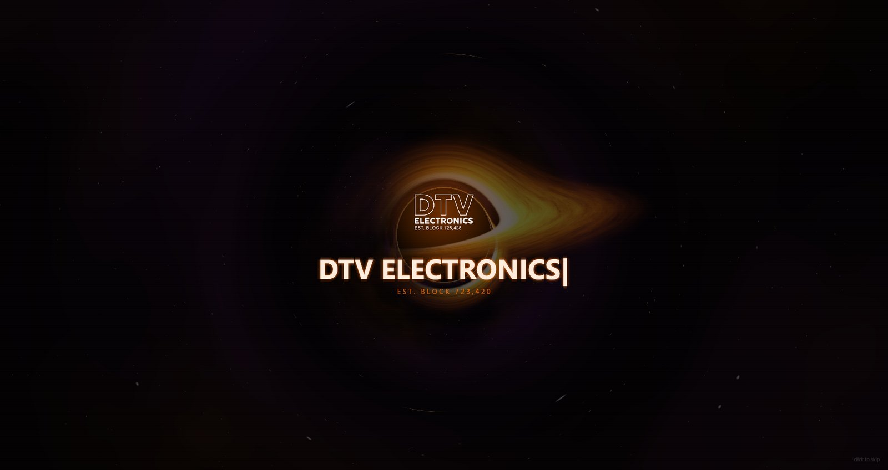 |
| 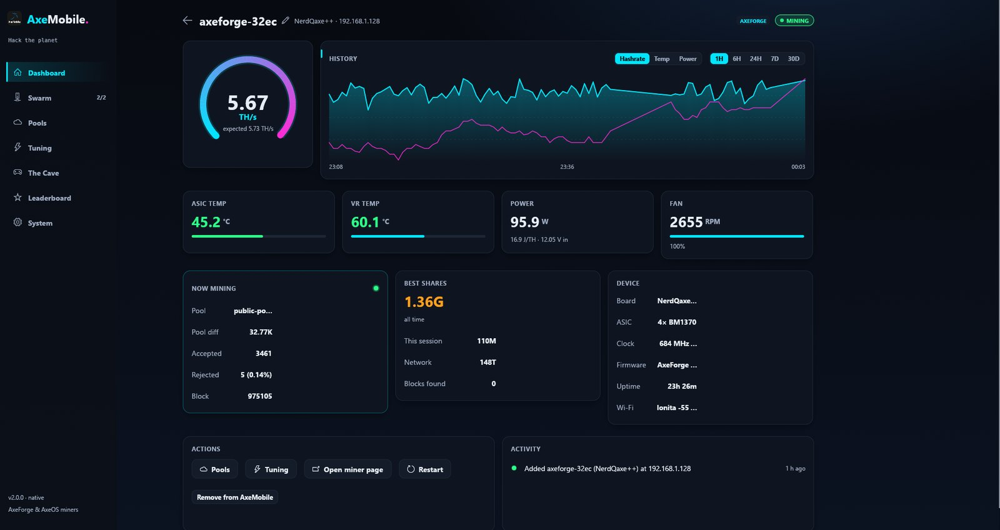 | 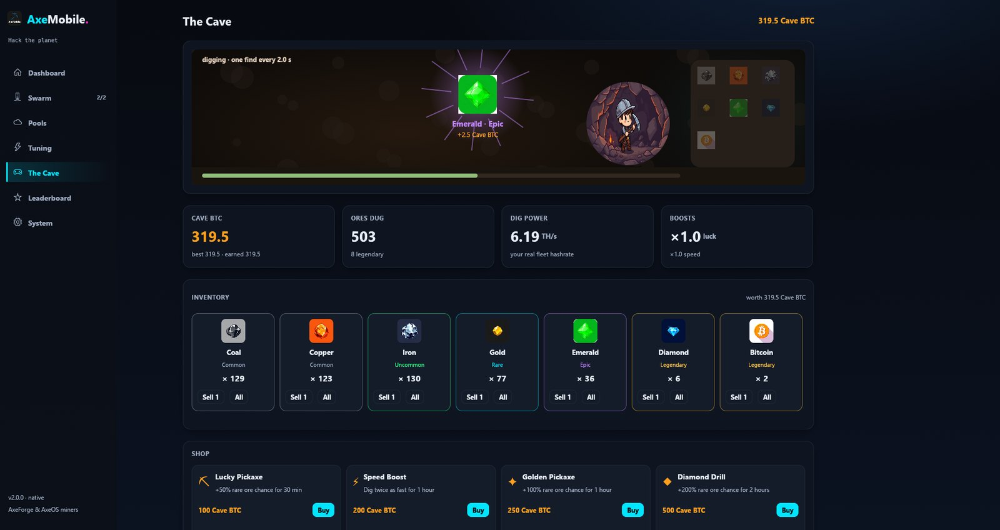 |
| 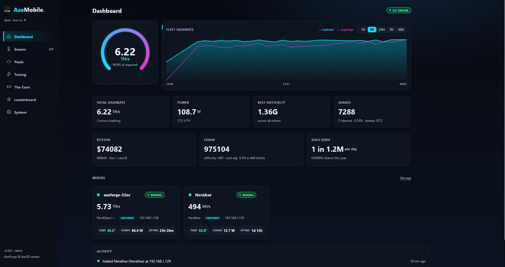 | 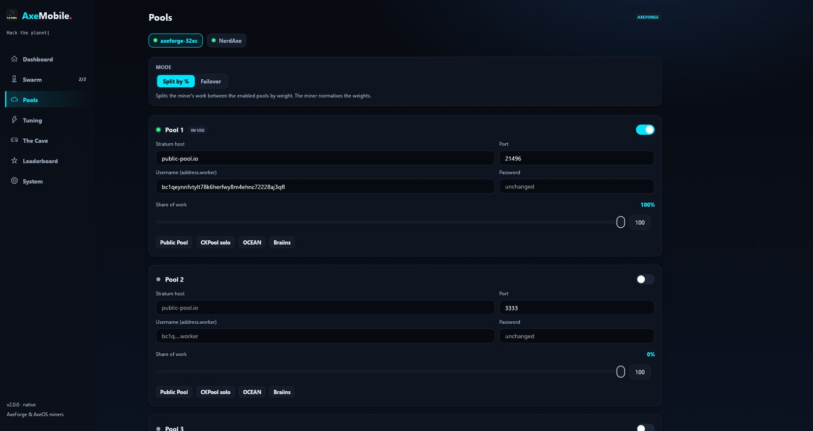 |
| 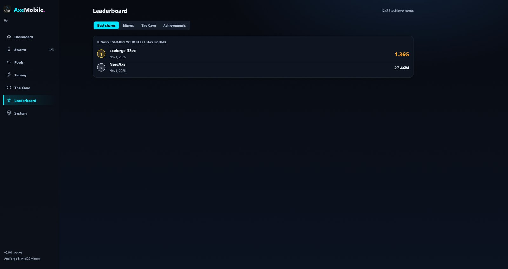 | 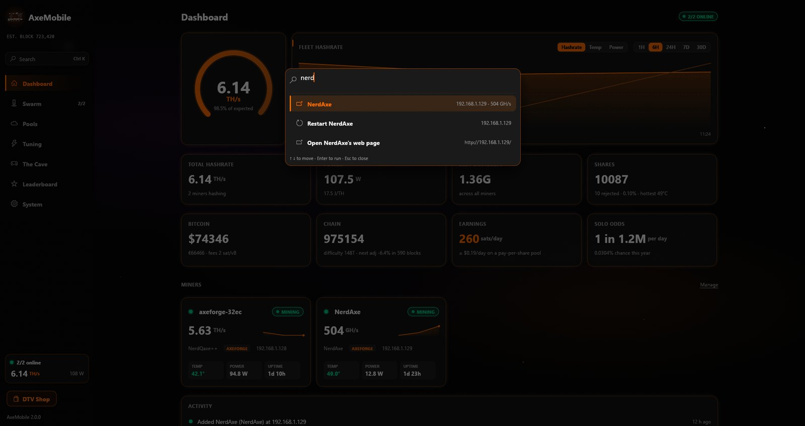 |
| 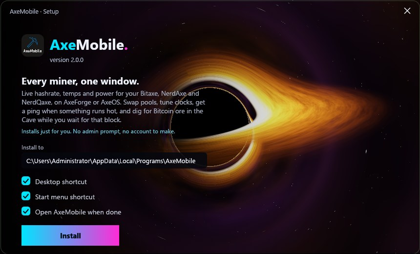 | 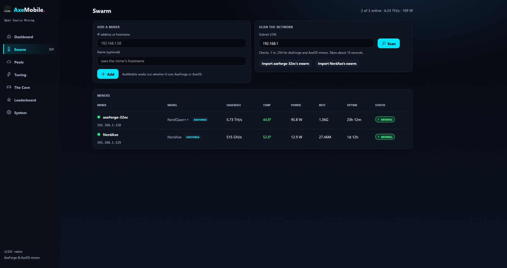 |

## Download

Grab the latest build from [Releases](https://github.com/IsSasoriDev/AxeMobile/releases).

- **Windows:** `AxeMobile-Setup-<version>.exe`. It installs for your user only, so there's no admin
  prompt. It adds Start menu and desktop shortcuts, and you can remove it from Apps & features.
- **macOS:** `AxeMobile-<version>-macOS.dmg`, for Apple silicon and Intel. Drag it to Applications
  and open it once, then add the widget from the widget gallery. The build isn't notarized yet, so the
  first time right-click the app and pick Open.
- **Linux:** the `.deb`, or the `.tar.gz` if you'd rather just run it.

Where your data lives: `%APPDATA%\AxeMobile` on Windows, `~/Library/Application Support/AxeMobile`
on macOS, `~/.local/share/axemobile` on Linux. The System page can export a backup (JSON) or your
history (CSV) whenever you want.

## Umbrel

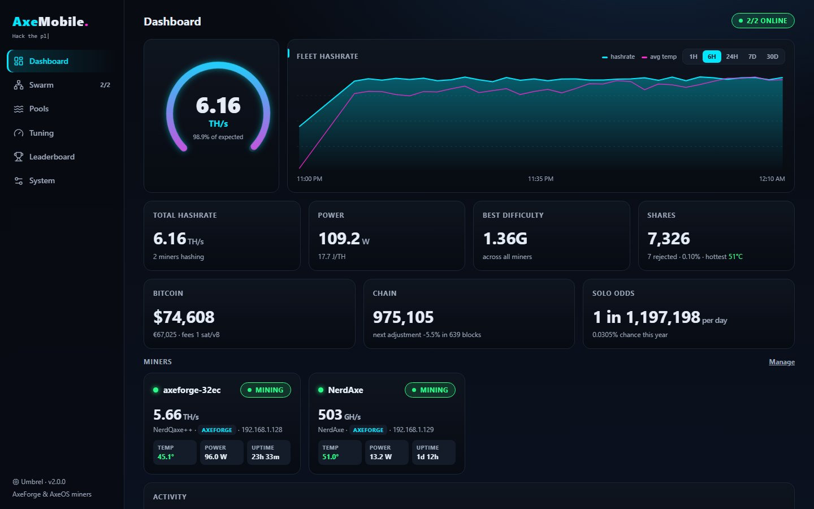

AxeMobile is a community app. In Umbrel go to **App Store → ⋯ → Community App Stores**, paste

```
https://github.com/IsSasoriDev/AxeMobile
```

and install it from there. It needs the Bitcoin Node app, which AxePool gets its block templates
from. Once the node is in sync, point your miners at your Umbrel's IP address on port 3334 with your
Bitcoin address as the username, e.g. `stratum+tcp://192.168.1.20:3334` and `bc1q….rig1`.

It runs the same engine as the desktop app and keeps its data in the app's
folder on your Umbrel. The package itself is in [`axemobile-main/`](axemobile-main).

Not on Umbrel? It runs anywhere Docker does:

```
docker run -d -p 3847:3847 -p 3334:3334 -v axemobile:/data ghcr.io/issasoridev/axemobile:2.2.0
```

For AxePool outside Umbrel, either fill in the node on the AxePool page or pass
`AXEMOBILE_NODE_URL`, `AXEMOBILE_NODE_USER` and `AXEMOBILE_NODE_PASS`.

## How it's put together

The desktop app is written in Rust with [egui](https://github.com/emilk/egui) and draws everything
itself on the GPU, including the black hole. The part that talks to your miners and the database run in the
same process. The Umbrel version runs that same engine as a small server with a React web UI on top.

```
crates/axe-core     talks to AxeForge and AxeOS, polls, stores history, runs AxePool, serves /api
crates/axe-desktop  the desktop app (Windows, macOS, Linux)
crates/axe-setup    the Windows installer
crates/axe-server   the server for Umbrel and Docker
src/                the web UI the server ships
axemobile-main/     the Umbrel package
packaging/          macOS app + widget, Linux .deb / .tar.gz
```

Miner endpoints it uses:

| | AxeForge | AxeOS |
|---|---|---|
| status | `GET /api/status` | `GET /api/system/info` |
| pools | `GET/POST /api/pools` | `PATCH /api/system` |
| tuning | `GET/POST /api/settings`, `POST /api/retune` | `PATCH /api/system` |
| restart | `POST /api/restart` | `POST /api/system/restart` |
| extras | `GET /api/swarm`, `POST /api/otp` | |

While the desktop app is open it also answers `http://127.0.0.1:3848/api/widget` with a short JSON
summary of your fleet. The Mac widget reads it, and anything else on your machine can too.

## Building

You'll need Rust (stable). For the web UI you'll also need Node 20 or newer.

```
# run the desktop app
cargo run -p axe-desktop

# Windows app + installer, ends up in dist-win\
powershell -ExecutionPolicy Bypass -File scripts\build-windows.ps1

# macOS app, widget and DMG, ends up in dist-mac/ (needs Xcode + `brew install xcodegen`)
bash packaging/macos/build-mac.sh

# Linux .deb and .tar.gz, ends up in dist-linux/
bash packaging/linux/build-linux.sh

# the Umbrel/Docker version: web UI + server on http://localhost:3847
npm ci && npm run build
cargo run -p axe-server
```

The **Desktop builds** workflow builds all three platforms on every pull request and attaches them to a
release when one is published. **Build Umbrel Docker Package** builds and pushes the container.

Server settings, if you run it yourself: `AXEMOBILE_PORT` (3847), `AXEMOBILE_BIND` (0.0.0.0),
`AXEMOBILE_DATA` (./data), `AXEMOBILE_WEB` (./dist), and `AXEMOBILE_TOKEN` if you want every API call
to need an `X-Axe-Token` header.

## Say thanks

If AxeMobile saves you some tab juggling, a few sats are always appreciated.

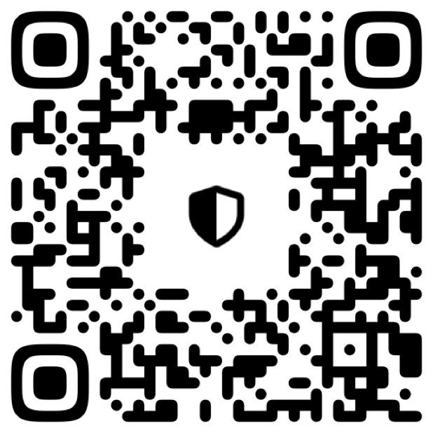

## License

MIT
